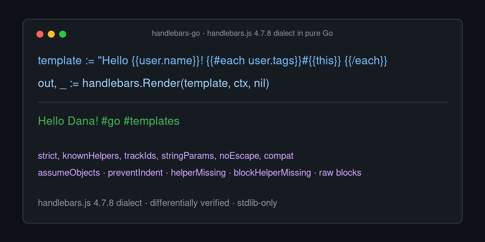

# handlebars-go



[aymerick/raymond](https://github.com/aymerick/raymond), the 643-star Go Handlebars port, lists **14 unimplemented options and features in its own README**, and its last code commit was in 2018. `handlebars-go` implements 12 of the 14 and names the 2 it does not (see the matrix below).

It renders [Handlebars](https://handlebarsjs.com/) templates in pure Go, differentially tested against handlebars.js 4.7.8 itself. Stdlib-only, no dependencies.

## What it does

- **All nine documented option flags**: `strict`, `noEscape`, `compat`, `knownHelpers`, `knownHelpersOnly`, `assumeObjects`, `preventIndent`, `stringParams`, `trackIds`: the nine options raymond's README says it never implemented.
- **The missing hooks**: `helperMissing` and `blockHelperMissing`, plus raw blocks (`{{{{helper}}}}...{{{{/helper}}}}` with the body passed verbatim).
- **Differentially tested**: 71 golden fixtures generated from **handlebars.js 4.7.8** (see `testdata/gen/`) covering interpolation, paths, sections, inverted sections, `each`/`with`/`if`/`unless`/`lookup`, subexpressions, partials (context, hash, indentation, nested), whitespace control, standalone lines, comments, `@root`, `@index`/`@key`/`@first`/`@last`, block params, and the option flags above. The test suite renders every fixture and compares byte-for-byte.
- **Fuzz-verified parser**: `go fuzz` ran 1.45M generated inputs with zero panics (it found a real nil-pointer bug before that, fixed and regression-covered). That's test evidence, not a proof.
- **Typed errors**: `TemplateError` names the line and column and quotes the offending text.
- **Fast enough to template in hot paths**: rendering `"Hello {{user.name}}! {{#each user.tags}}…"` measured 5.0µs/op, parsing the same template 6.1µs/op (BenchmarkExecute/BenchmarkParse, GitHub-hosted runner class machine; see `bench_test.go`).
- **HTML-escapes by default** with handlebars.js' exact escape map (`& < > " ' \` =`); `{{{triple}}}`, `{{& amp}}`, or `noEscape` to bypass.

## What it doesn't do

- **Decorators, inline partials, and partial-block**: not implemented yet (`{{#* inline}}` and `{{> @partial-block}}` are parse errors for now).
- **`@contextPath` and `@level`**: the two raymond-limitation items this library also does not implement (the trackIds metadata var and log-level plumbing). A plain `log` helper ships.
- **JS insertion-order map iteration**: Go maps have no insertion order, so `{{#each}}` over a map iterates **sorted keys**. Named dialect difference: handlebars.js preserves insertion order.
- **No default `raw` helper**: same as handlebars.js. Register the shipped one explicitly: `handlebars.RawHelper`.
- **Not a raymond API clone**: similar shape (`Parse`/`Execute`/`Render`), not a drop-in replacement.
- Early stage: not yet independently reviewed. Report issues freely.

## Install

```bash
go get github.com/ofershap/handlebars-go
```

## Example

```go
package main

import (
	"fmt"

	"github.com/ofershap/handlebars-go"
)

func main() {
	out, err := handlebars.Render(
		"Hello {{user.name}}! {{#each user.tags}}#{{this}} {{/each}}",
		map[string]any{"user": map[string]any{
			"name": "Dana",
			"tags": []string{"go", "templates"},
		}},
		nil,
	)
	if err != nil {
		panic(err)
	}
	fmt.Println(out)
	// Output: Hello Dana! #go #templates
}
```

Strict mode turns missing fields into errors instead of empty strings:

```go
opts := &handlebars.Options{Strict: true}
_, err := handlebars.Render("{{user.nmae}}", ctx, opts) // typo caught at render time
```

## Options

| Option | Effect |
|---|---|
| `Strict` | Missing fields error instead of rendering "" |
| `NoEscape` | Disable HTML escaping globally |
| `Compat` | Recursive field lookup up the context stack (deprecated handlebars.js mode) |
| `KnownHelpers` / `KnownHelpersOnly` | Control which names resolve as helpers |
| `AssumeObjects` | Skip existence checks on path traversal; missing mid-path is an error (matches handlebars.js, which throws) |
| `PreventIndent` | Don't auto-indent standalone partials |
| `StringParams` | Unresolved helper params resolve to their name string |
| `TrackIds` | Record the id string each param resolved from (`HelperCall.Ids`) |
| `Helpers` / `Partials` / `Data` | Per-render helper registry, partial registry, and `@data` vars |

## Compared to raymond

[aymerick/raymond](https://github.com/aymerick/raymond) (tested at commit `7c01a03`, 643 stars) is the incumbent. Its README's own *Limitations* section lists nine options and five features as not implemented; its last code commit is from March 2018. Here is every item, honestly:

| raymond README limitation | handlebars-go | Verified by |
|---|---|---|
| `strict` option | implemented | golden `missing-strict` |
| `noEscape` | implemented | golden `interp-noescape-opt` |
| `compat` (recursive lookup) | implemented | goldens `compat-recursive`, `no-compat-no-recursive` |
| `knownHelpers` | implemented | unit `TestKnownHelpers` |
| `knownHelpersOnly` | implemented | golden `known-helpers-only` |
| `trackIds` | implemented | unit `TestTrackIds` |
| `assumeObjects` | implemented | golden `assume-objects` |
| `preventIndent` | implemented | golden `partial-prevent-indent` |
| `stringParams` | implemented | golden `string-params` |
| raw block content param | implemented | golden `raw-block` (register `RawHelper`) |
| `blockHelperMissing` hook | implemented | golden `block-helper-missing-hook` |
| `helperMissing` hook | implemented | golden `helper-missing-hook` |
| `@contextPath` (trackIds mode) | **not implemented** | listed in What it doesn't do |
| `@level` / log levels | **not implemented** | listed in What it doesn't do |

12 of 14. Where behavior overlaps with raymond, this library verifies against handlebars.js 4.7.8 itself (golden fixtures), not self-authored expectations.

## Differential testing

`testdata/goldens.json` is generated by `testdata/gen/gen.js` from a pinned handlebars.js 4.7.8 (`package-lock.json` included). `differential_test.go` renders every case through this library and compares byte-for-byte. Regenerate with:

```bash
cd testdata/gen && npm ci && node gen.js > ../goldens.json
```

Cases where the two engines intentionally differ (map iteration order) are excluded from the corpus and documented above.

## FAQ

<details>
<summary><b>How do I render Handlebars templates in Go?</b></summary>
`go get github.com/ofershap/handlebars-go`, then `handlebars.Render(template, context, nil)`. For repeated renders, `Parse` once and call `Execute` per context; it's about 5µs per render of a small template.
</details>

<details>
<summary><b>What's the difference between handlebars-go and raymond?</b></summary>
raymond is the community port from 2015-2018; its README documents 14 unimplemented options and features (strict mode, knownHelpers, noEscape, helperMissing, blockHelperMissing, trackIds and more). handlebars-go implements the full documented surface and verifies behavior against handlebars.js 4.7.8 with byte-exact golden fixtures instead of self-authored tests.
</details>

<details>
<summary><b>Does it support strict mode?</b></summary>
Yes: `&handlebars.Options{Strict: true}` turns missing fields into `TemplateError`s with line and column. Useful for catching template typos in CI.
</details>

<details>
<summary><b>Is it safe to render untrusted templates?</b></summary>

The trust boundary, plainly:

- **Template text = code-author trust.** A template names helpers and partials, and helpers run with your program's privileges (verified in `security_test.go`). `{{triple}}` / `{{& amp}}` / `SafeString` bypass HTML escaping by design. Do not render template text authored by an untrusted party. There is no sandbox and this library makes no sandbox claim.
- **Template data may be hostile.** Ordinary `{{...}}` interpolation is HTML-escaped with handlebars.js' exact escape map; `{{triple}}`, `{{& amp}}` and `SafeString` bypass it by design (JS parity, listed above). HTML escaping protects HTML text output only - it is not URL, JS or CSS context sanitization, so validate values before placing them in those contexts. Map keys beginning with `__` are not accessible: a local guard against prototype-style keys, not differentially verified as exact handlebars.js property-lookup parity. Exported zero-arg methods on data structs ARE callable from templates (raymond-compatible), so pass only data you are comfortable exposing.
- **Hostile template TEXT**: the parser is fuzz-tested (1.45M generated inputs, zero panics) and errors are typed with line/column. Recursive partials stop at depth 100 with an error; 2000-deep nested blocks are covered by test.
- **No resource caps.** Output size and loop counts are bounded by your data, not by the engine (a 100k-iteration `each` will produce 100k iterations of output). If data size is attacker-controlled, bound it before rendering.
- Early-stage library; not independently audited.
</details>

<details>
<summary><b>Can I use it for LLM/agent output templating?</b></summary>
Yes, that's a design goal: reports, prompts, and multi-file agent output. Strict mode and typed errors are aimed at agent pipelines where a silently-empty `{{field}}` is a bug, not a feature.
</details>

---

## Contributing

Issues and PRs welcome - see [CONTRIBUTING.md](CONTRIBUTING.md). Please report security issues privately per [SECURITY.md](SECURITY.md).

---

More projects: [gitshow](https://github.com/ofershap/gitshow) · [real-browser-mcp](https://github.com/ofershap/real-browser-mcp) · [cursor-usage-tracker](https://github.com/ofershap/cursor-usage-tracker) · [mcp-server-markdown](https://github.com/ofershap/mcp-server-markdown) · [readme-builder](https://github.com/ofershap/readme-builder) · [grok-bot-skills](https://github.com/ofershap/grok-bot-skills) · [mashov-parent-brief](https://github.com/ofershap/mashov-parent-brief) · [gailwind](https://github.com/ofershap/gailwind) · [lather](https://github.com/ofershap/lather)

---

## Author

[](https://gitshow.dev/ofershap)

[](https://linkedin.com/in/ofershap)
[](https://github.com/ofershap)
[](https://ofershap.github.io/)

---

<sub>README built with [README Builder](https://ofershap.github.io/readme-builder/)</sub>

## License

[MIT](LICENSE) &copy; [Ofer Shapira](https://github.com/ofershap).
